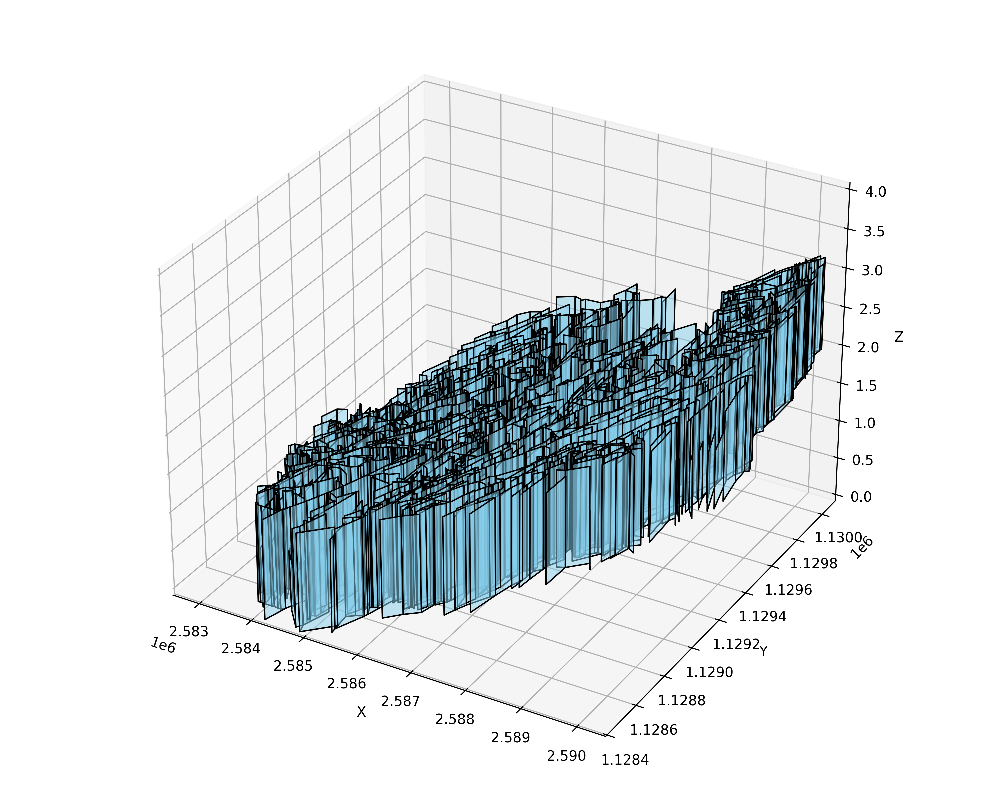

# fracextrude
Transforming 2D fracture networks in 3D frameworks with dips and extrusion.
<br>


<br/>

This repository is associated with my phD research.
The aim is to extrude a 2D fracture network graph to a 3D framework and test different approaches to generate 3D graphs from the 3D framework.


<br/>

## Data description

### Files

In the "data/graphs" folder, you will find:

- The fracture network as graphs
  - Filename: `tsan_fracgraph.pickle`

- The generated table with dip, dipdirection and azimuths
  - Filename: `tsan_3d_dipdir.csv`

- The labeled plane and points of the fractures and the coordinates x,y,z
  - Filename: `tsan3d.csv`

## Dependencies

Use the package manager [pip](https://pip.pypa.io/en/stable/) to install the following packages.

```bash
pip install numpy networkx matplotlib pickle mpl_toolkits.mplot3d Poly3DCollection
```
                
## Examples

Jupyter notebook examples to characterize the networks, analyze, and export:

- Ex01_-_Extruding 2D to 3D networks.ipynb
- Ex02_-_Extruding_fracture_networks_2D_3D_graphs.ipynb
